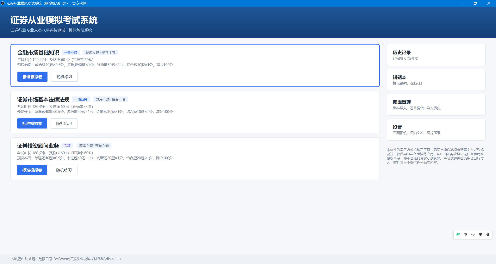
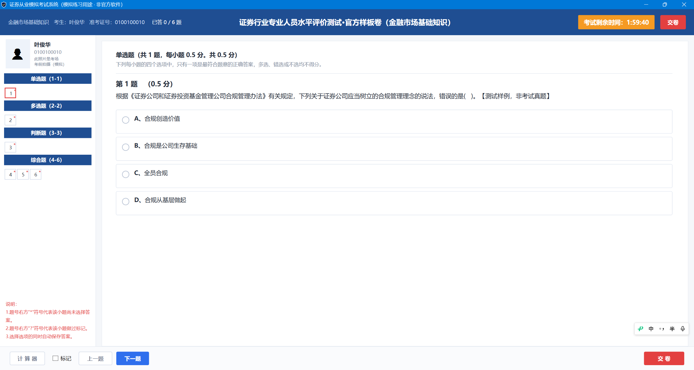
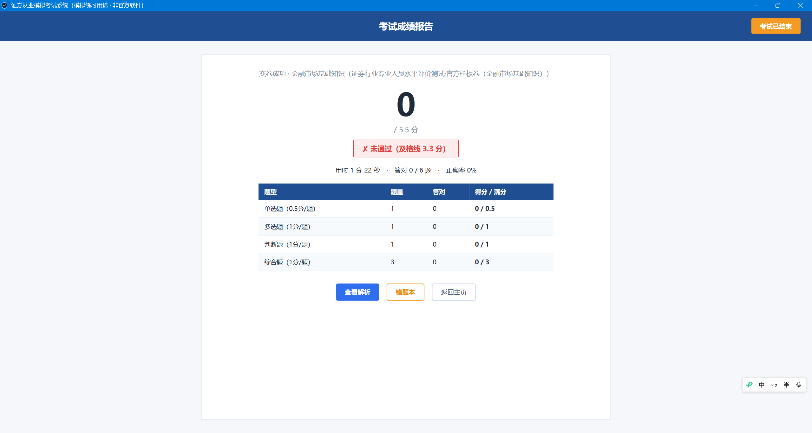
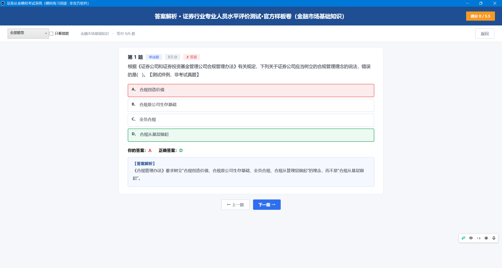
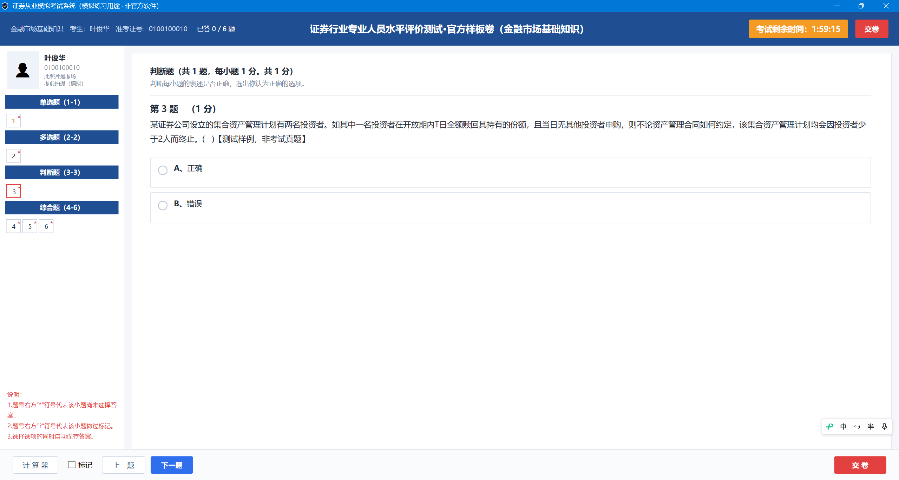
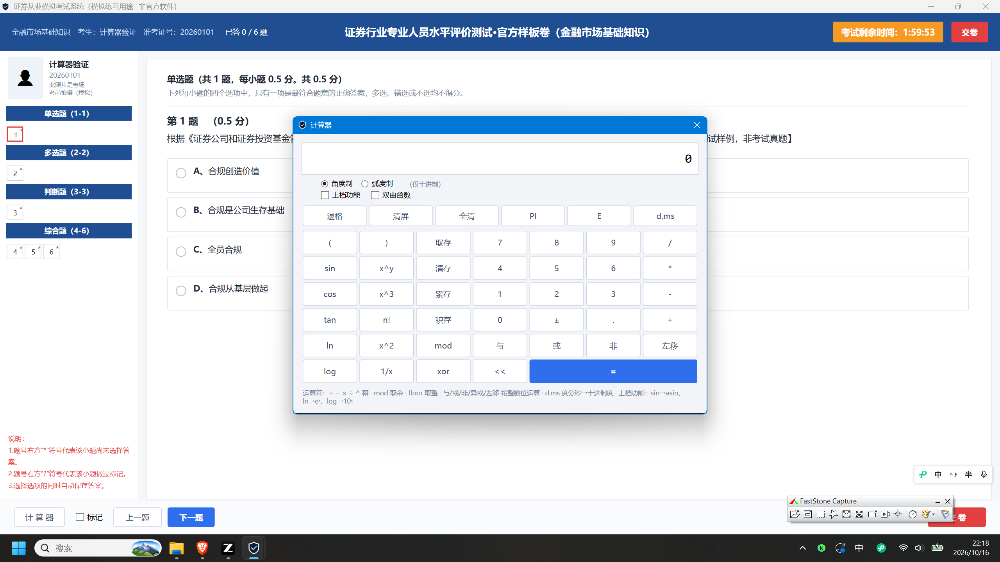
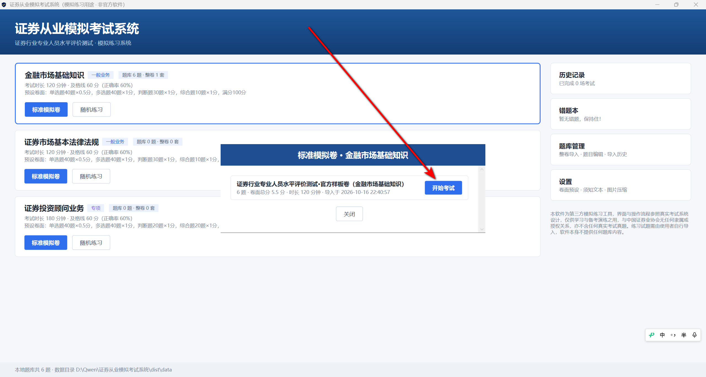

# 证券从业模拟考试系统（SacExam）

> Windows 单机桌面模拟考试软件 · C# WPF (.NET 8) + SQLite · 免安装、免联网、离线使用
>
> **本仓库不内置、不分发任何考试真题。所有练习试题均由使用者自行导入，软件本身不提供任何题库内容。**

| 主界面                                    | 答题页                                    |
| ----------------------------------------- | ----------------------------------------- |
|  |  |

## ⚠️ 合规与免责声明

本软件为第三方模拟练习工具，界面与操作流程参照真实考试系统设计，**仅供学习与备考演练之用，与中国证券业协会无任何隶属或授权关系**，亦不含任何真实考试真题。练习试题需由使用者自行导入，软件本身不提供任何题库内容；使用者应确保所导入内容拥有合法权利，因导入内容产生的一切纠纷与本项目无关。

## ✨ 功能特性

- **两种出卷方式**
  - 标准模拟卷：整卷原样开考，题型、数量、顺序、分值、时长完全以导入的试卷为准；
  - 随机练习：按科目、题型数量/分值（可调）、时长从题库抽题组卷，同卷不重复。
- **协会机考风格答题页**：左侧题号区（`*` 未答 / `?` 标记 / 浅蓝已答 / 红框当前题）、橙色倒计时（最后 5 分钟变红闪烁、归零自动交卷）、内置科学计算器（三角/对数/幂/阶乘/位运算/记忆键）。
- **沉浸式考前流程**：登录 → 考生信息确认 → 考场须知（滚动到底激活）→ 答题 → 交卷确认 → 成绩报告。
- **自动保存与恢复**：作答即时落库，断电/强退后下次启动可恢复剩余时间与作答。
- **计分与错题本**：答案归一化比较，全对才得分；0.5 分题成绩保留一位小数；错题自动进入错题本，重做答对自动移出。
- **成绩报告与解析**：题型得分表、用时/答对/正确率；逐题回放你的答案/正确答案/解析全文，支持只看错题、按题型筛选。
- **整卷导入向导**：支持 xlsx / CSV / JSON 三种格式，逐行校验、错误行红显、可导出错误报告；**不查重**（相似题可共存）。
- **图片体系**：题干/选项/解析三处支持图片（xlsx 图片列、xlsx 内嵌图按锚点行归属、`{{img:文件名}}` 内联占位、编辑器 Ctrl+V 粘贴截图），SHA-256 入库、同内容自动合并、超大图自动压缩、点击放大查看。
- **题库管理**：试卷列表、题目编辑、整卷再导出（模板 xlsx + 图片文件夹）、zip 备份与恢复。
- **全量可配置**：题型/题量/分值/时长预设、及格率、倒计时提醒、考场须知文本等（见「设置」）。

### 默认卷面预设（可在设置中调整）

| 科目                     | 时长     | 单选题      | 多选题    | 判断题    | 综合题（不定项） | 满分 |
| ------------------------ | -------- | ----------- | --------- | --------- | ---------------- | ---- |
| 金融市场基础知识         | 120 分钟 | 40 × 0.5 分 | 40 × 1 分 | 30 × 1 分 | 10 × 1 分        | 100  |
| 证券市场基本法律法规     | 120 分钟 | 40 × 0.5 分 | 40 × 1 分 | 30 × 1 分 | 10 × 1 分        | 100  |
| 证券投资顾问业务（专项） | 180 分钟 | 40 × 0.5 分 | 40 × 1 分 | 20 × 1 分 | 20 × 1 分        | 100  |

及格线 = 卷面总分 × 60%。多选题与综合题一律**全对才得分**（不提供按比例给分）。

## 🖼️ 更多截图

| 成绩报告                                      | 答案解析                                      |
| --------------------------------------------- | --------------------------------------------- |
|  |  |

| 判断题                                        | 科学计算器                                    | 选择试卷                                  |
| --------------------------------------------- | --------------------------------------------- | ----------------------------------------- |
|  |  |  |

## 🚀 快速开始

### 方式一：下载 Release（推荐）

1. 前往 [Releases](../../releases) 下载最新版压缩包（如 `SacExam-v3.1.0-win-x64.zip`）并解压，内附使用说明；
2. 双击 `证券从业模拟考试系统.exe` 运行（无需安装 .NET、无需管理员权限）；
3. 首次启动为**空题库**，请先到「题库管理 → 整卷导入」导入试卷（见下文格式说明）。

> 首次运行如遇 Windows SmartScreen 提示，点击「更多信息 → 仍要运行」即可；个别杀毒软件可能对单文件自解压程序误报，可添加信任或自行从源码构建。

### 方式二：从源码构建

```powershell
# 需要 .NET 8 SDK（Windows 10/11）
git clone https://github.com/GitHubOctopuses/sac-exam-simulator.git
cd sac-exam-simulator
dotnet publish src -c Release -r win-x64 --self-contained true `
  -p:PublishSingleFile=true -p:IncludeNativeLibrariesForSelfExtract=true `
  -p:DebugType=none -o dist
# 或直接运行 tools/publish.ps1
```

## 📦 题库导入格式

导入以「一整个文件 = 一套整卷」为单位，不强制章节、不查重。支持三种格式：

### Excel（主通道）

使用 [docs/整卷导入模板.xlsx](docs/整卷导入模板.xlsx)，标准表头 12 列（前 9 列即可直接导入，后 3 列为可选图片列）：

| 列  | 表头               | 说明                                                               |
| --- | ------------------ | ------------------------------------------------------------------ |
| A   | 题型               | 单选题 / 多选题 / 判断题 / 综合题（"不定项选择题"也接受）          |
| B   | 题目               | 题干；综合题以 `【案例材料】` 开头；支持 `{{img:文件名}}` 内联图片 |
| C–F | 选项1–4            | 选项文本（可带 `A、` 前缀）；判断题填 `A、正确`、`B、错误`         |
| G   | 正确答案           | 单选 `C`；多选 `ABD`；判断 `A/B/正确/错误/对/错/√/×` 均可          |
| H   | 答案解析           | 可空                                                               |
| I   | 分值               | 留空按预设补齐（单选 0.5，其余 1）                                 |
| J–L | 题干/选项/解析图片 | 图片文件名，多个用 `;` 分隔；选项图片格式 `A:tu.png;C:tu2.png`     |

### CSV

与 Excel 同列名，UTF-8（带 BOM 优先），支持引号包裹的多行文本。

### JSON（`sac-mock-exam-paper` 格式）

见 [samples/示例卷-格式演示.json](samples/示例卷-格式演示.json)：

```json
{
  "format": "sac-mock-exam-paper",
  "format_version": "1.0",
  "paper": { "name": "示例卷", "subject": "金融市场基础知识", "duration_minutes": 60 },
  "questions": [
    {
      "no": 1, "type": "单选题", "case_material": null,
      "stem": "题干……", "options": ["A、……", "B、……", "C、……", "D、……"],
      "answer": "C", "analysis": "解析……", "score": 0.5, "chapter": null,
      "images": { "stem": [], "options": {}, "analysis": [] }
    }
  ]
}
```

导入向导提供三步流程：选择文件 → 解析预览与校验（错误行红显原因，可「仅导入无错误行」）→ 确认导入（生成错误报告 CSV）。图片文件放在试卷同目录或 `images/` 子目录即可被自动发现。

## 🛠️ 命令行参数

| 参数                                             | 说明                                             |
| ------------------------------------------------ | ------------------------------------------------ |
| `--selftest [整卷.json]`                         | 自动化自测（导入/识别/计分/恢复/随机组卷等断言） |
| `--seed <文件> [--subject 科目名] [--name 卷名]` | 不打开界面，直接导入整卷到本地题库               |
| `--calc`                                         | 独立打开科学计算器                               |
| `--db <目录>`                                    | 指定数据目录（默认 exe 旁 `data\`）              |

## 💾 数据存储与备份

- 数据库：`data\sacexam.db`（SQLite 单文件）；图片：`data\images\`（SHA-256 命名）；
- exe 目录不可写时自动回退到 `%LOCALAPPDATA%\SacExam\data`；
- 「题库管理」可一键打包 zip 备份（数据库 + 图片），并支持恢复；
- 换电脑迁移：直接拷贝整个程序目录即可。

## 📁 目录结构

```
├── src/                  # C# WPF 源码（.NET 8）
│   ├── Services/         # SQLite 数据层 / 导入 / 考试计分 / 图片 / 导出 / 设置 / 自测
│   └── Views/            # 各界面（主菜单 / 答题页 / 计算器 / 导入向导 / 题库管理等）
├── docs/                 # 整卷导入模板、截图
├── samples/              # 导入格式示例 JSON
├── tools/                # 本地发布脚本
└── .github/workflows/    # CI（Windows 构建）
```

## ❓ 常见问题

- **打开后题库是空的？** 本软件不提供任何题目。请先导入整卷；`samples/示例卷-格式演示.json` 可用来快速体验导入与考试流程。
- **随机练习提示题量不足？** 题库中该题型数量少于预设卷面数量，可调低「设置 → 卷面预设」中的数量。
- **误删/换机如何迁移？** 使用「题库管理 → 备份题库（zip）」，在新机器上「从备份恢复」。
- **图片不显示？** 支持 png/jpg/gif/bmp/webp；webp 可入库但部分环境无法预览；缺失图片会以占位提示导入。
- **可以导入网上下载的题库吗？** 技术上支持，但请自行确认拥有合法权利，本项目不分发任何题目。

## 🤝 参与

欢迎 Issue 与 PR：修复缺陷、完善导入格式兼容性、补充单元测试等。**请勿向本仓库提交任何真实考试真题或受版权保护的题目内容**，此类 PR 将被拒绝。详见 [CONTRIBUTING.md](CONTRIBUTING.md)。

## 📄 许可证

[MIT License](LICENSE)。本仓库包含的源代码、文档与模板可自由使用；使用者自行导入的题库内容，其权利与责任归使用者所有。
